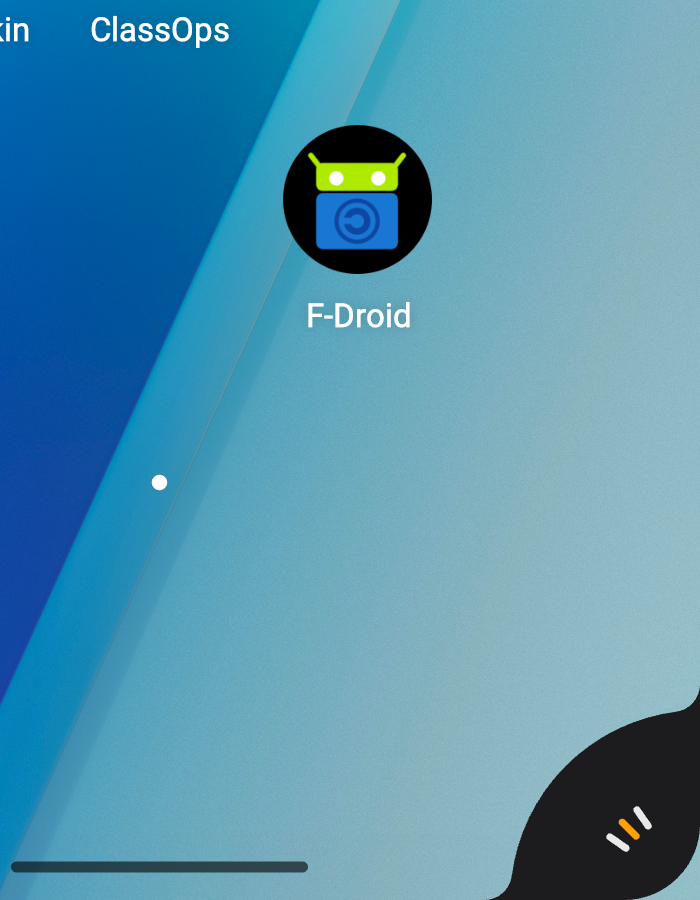
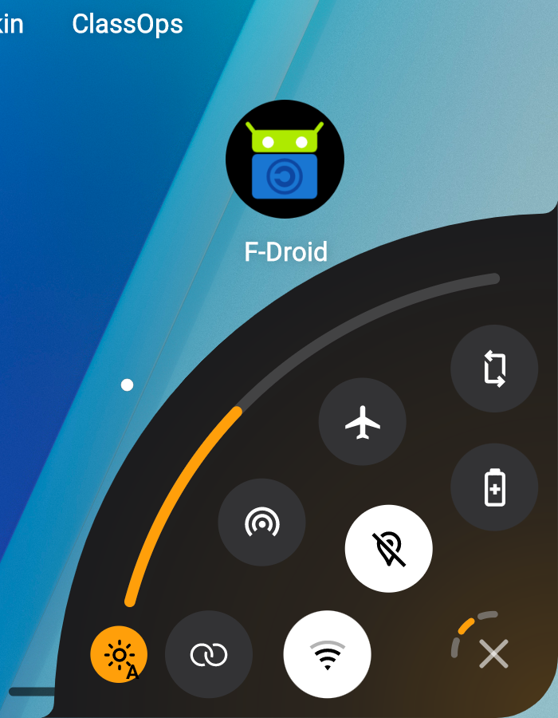
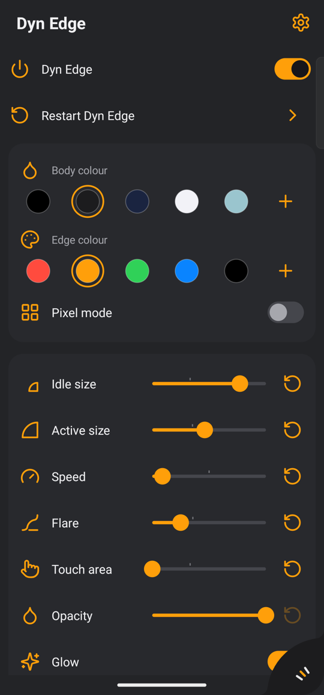

# Dyn Edge

A small living corner for Android. A black bean sits in the bottom corner of the screen, over every
app. Tap or drag it and it springs open into a quarter-circle panel with swipeable windows: quick
toggles, media, apps, clipboard, timer, notifications and device stats. While closed it shows what is
going on: a running timer, a download, charging, a call, or a music visualiser that moves with the beat.

No AndroidX, no Compose, and no work while idle.

| Idle | Open | Live timer | Settings |
| --- | --- | --- | --- |
|  |  |  |  |

## What it does

- **Quick toggles** in two rings: Wi-Fi, Bluetooth, torch, Do Not Disturb, rotation, location, dark mode,
  the phone's own quick settings tiles, third-party tiles and your own shortcuts. Brightness and volume arcs
  along the rim.
- **Windows** you can turn on, off and reorder: Quick, Media, Apps, Clipboard, Volume, Timer, Notifications,
  Device.
- **Live activities** on the closed bean: timers, downloads, uploads, charging, calls (answer / decline),
  track changes.
- **Music visualiser** (Bars, Spectrum, Wave, Dots) synced to the phone's real audio output delay, plus an
  optional beat bounce.
- **Your look:** body and edge colours, gradient, glow, opacity, flare, sizes, floating mode with adjustable
  corner roundness, left or right corner, pixel-art mode, saved looks.
- **Long press** the bean to hide it, open notifications, take a screenshot, lock, or flip any tile you pick.
- **Pause in sensitive apps** such as banking apps: the edge steps aside while they are open.
- **Live test** in the settings plays every effect on the real edge, one at a time.

## Install

1. Download `DynEdge-v<version>.apk` from the [latest release](../../releases/latest) and install it.
2. Open Dyn Edge and follow the permission banner. The edge itself is an accessibility service (it only
   reads whether the keyboard is open). On Android 13 and later, sideloaded apps need
   **App info > three-dot menu > Allow restricted settings** before the accessibility switch can be turned on.
3. Optional extras: notification access (media and live activities), Do Not Disturb access, modify system
   settings (brightness), microphone (music visualiser, the audio is never recorded or stored).

With a computer, `tools/install.ps1` installs the APK over adb and grants everything in one step.

## Build

Needs JDK 21 and the Android SDK.

```
./gradlew assembleRelease
```

The APK lands in `app/build/outputs/apk/release/app-release.apk`. Package `com.dynedge`, minSdk 30.

## Remove

Uninstall the app like any other, or `adb uninstall com.dynedge`.
