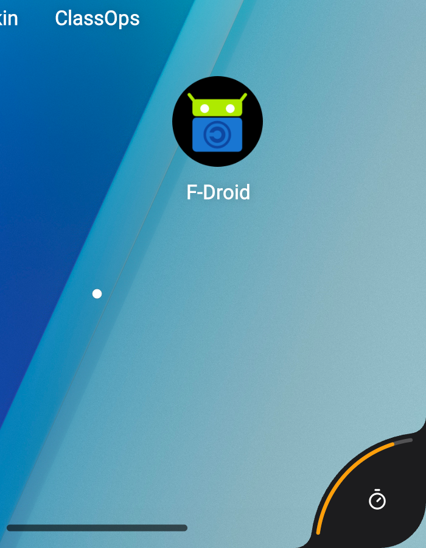

# Dyn Edge

A small living corner for Android. A black bean sits in the bottom corner of the screen, over every
app. Tap or drag it and it springs open into a quarter-circle panel with swipeable windows: quick
toggles, media, apps, clipboard, timer, notifications and device stats. While closed it shows what is
going on: a running timer, a download, charging, a call, or a music visualiser that moves with the beat.

No AndroidX, no Compose, and no work while idle. Made by Jude CJ.

| Idle | Open | Live timer | Settings |
| --- | --- | --- | --- |
|  |  |  |  |

## What it does

- **Quick toggles** in two rings: Wi-Fi, Bluetooth, torch, Do Not Disturb, rotation, location, dark mode,
  the phone's own quick settings tiles, third-party tiles and your own shortcuts. Brightness and volume arcs
  along the rim.
- **Windows** you can turn on, off and reorder: Quick, Media, Apps, Clipboard, Volume, Timer, Notifications,
  Device.
- **Live activities** on the closed bean: timers, downloads, uploads, charging, calls (answer / decline),
  track changes.
- **Music visualiser** (Bars, Spectrum, Wave, Dots) synced to the phone's real audio output delay, plus an
  optional beat bounce.
- **Your look:** body and edge colours, gradient, glow, opacity, flare, sizes, floating mode with adjustable
  corner roundness, left or right corner, pixel-art mode, saved looks.
- **Long press** the bean to hide it, open notifications, take a screenshot, lock, or flip any tile you pick.
- **Pause in sensitive apps** such as banking apps: the edge steps aside while they are open.
- **Live test** in the settings plays every effect on the real edge, one at a time.

## Install

1. On your phone, open the [latest release](../../releases/latest) and tap `DynEdge-v<version>.apk` to download it.
2. Open the downloaded file. If the phone asks, allow your browser or Files app to install unknown apps.
3. If Play Protect shows a warning, tap **More details > Install anyway**. It warns about every app installed
   outside the Play Store. Dyn Edge is open source and signed by its author.
4. Open Dyn Edge. A **Set up Dyn Edge** list walks you through each step in order and ticks them off:
   - **Allow restricted settings** (Android 13 and later): in App info tap the three-dot menu, then
     Allow restricted settings. Without this the accessibility switch stays greyed out.
   - **Turn on Dyn Edge** in Accessibility. This is the only required step. Dyn Edge only checks whether
     the keyboard is open, and never reads what is on screen.
   - Optional: keep it running (battery), notification access (music and live activities), microphone
     (visualiser only, nothing is recorded), brightness, Do Not Disturb and usage access.

Updating: install the new APK over the old one, and your settings stay. Versions before 1.8.1 were signed
differently, so uninstall those once before installing 1.8.1 or later.

With a computer, `tools/install.ps1` installs the APK over adb and grants everything in one step.

## Build

Needs JDK 21 and the Android SDK.

```
./gradlew assembleRelease
```

The APK lands in `app/build/outputs/apk/release/app-release.apk`. Package `com.dynedge`, minSdk 30.

## Remove

Uninstall the app like any other, or `adb uninstall com.dynedge`.
